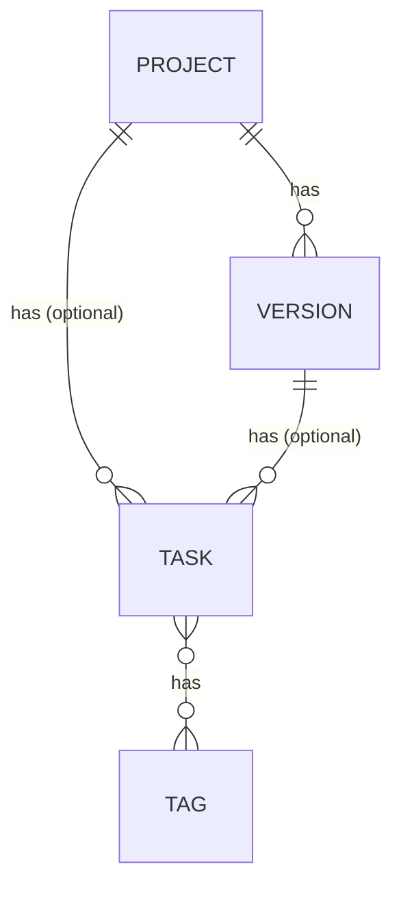
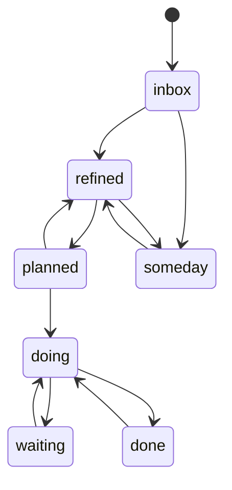

# Architecture overview

## Domain model

`Project → Version → Task`, one-to-many at each level. `Task.project_id`
and `Task.version_id` are independently nullable — this is the mechanism
behind the GTD workflow, not an edge case:

- `project_id IS NULL` → raw capture, not yet attached to a project
- `version_id IS NULL` → not yet planned (needs refining)
- both set → planned into a milestone

`Tag` is a free-form label, many-to-many with `Task` via a plain
association table. The `Event` table (append-only mutation log) isn't
shown here: it has no foreign keys by design, referencing any entity by
`entity_type` + `entity_id` so a log entry survives deletion — see
[0002](adr/0002-append-only-event-log.md).

## Task lifecycle

`waiting` requires a non-empty `blocked_reason`. Transition rules are
enforced in the services layer, implemented in `services/tasks.py` — see
[0001](adr/0001-services-ignore-http.md).

Within `services/`, mutations and cross-cutting reads are split into
separate modules: `services/tasks.py` (and `projects.py`, `versions.py`)
own single-entity commands, while `services/views.py` holds read-only,
page-shaped queries (`inbox`, `to_refine`, `search`, `dashboard`) that
don't belong to any one entity. Both stay framework-agnostic per ADR-0001.

Two further modules are read-only: `services/events.py` also holds the
event-log readers (`history`, `changelog`, see
[0002](adr/0002-append-only-event-log.md)), and `services/export.py`
provides `dump_json()`, a full database dump (projects, versions with their
definition of done, tasks with their tags, tags, events). Enums are exported
by name and dates in ISO 8601. There is no import.

## Web pages

Routes are unprefixed full-page adapters (`web/routes_pages.py`):

- `/` is the dashboard: in-progress versions with done/total progress,
  `doing` and `waiting` tasks, inbox and refine counters
  (`views.dashboard()` returns a `DashboardView`).
- The task page shows its History; the version page shows its Changelog.
- `GET /export.json` downloads the export as an attachment.
- The nav bar links Dashboard, Projects, Tasks, Inbox, Refine, Search and
  Export.

## Decisions

See [Decisions](adr/0001-services-ignore-http.md) for the full ADR journal.
