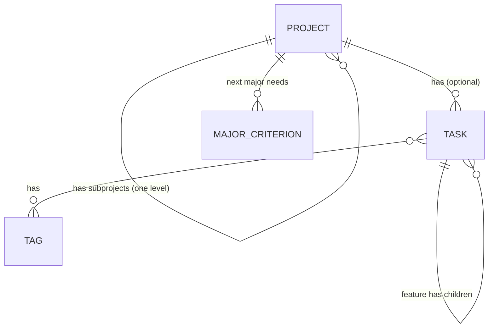
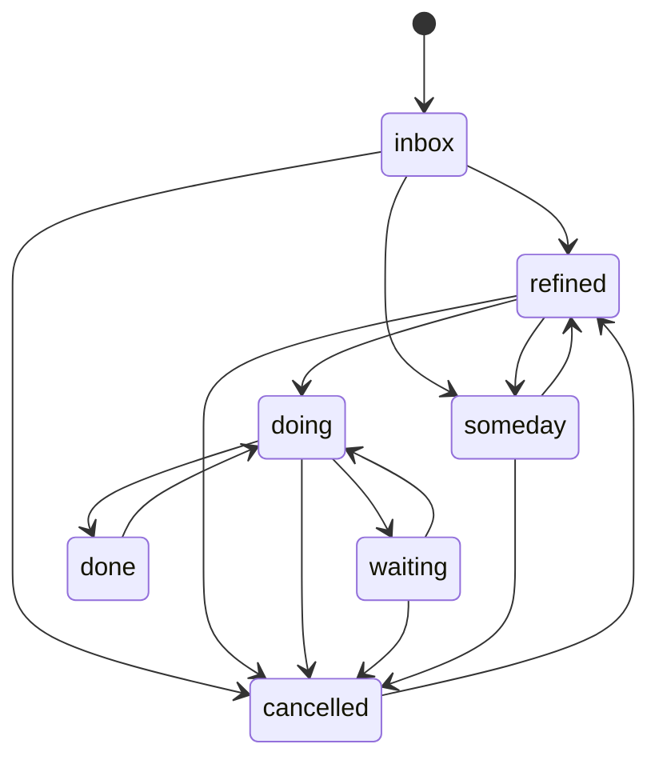
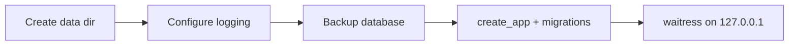

# Architecture overview

## Domain model

A work tree ([0013](adr/0013-project-feature-task-tree.md)): root projects,
their subprojects (one level), then features and tasks under them.
Features and tasks share the `task` table, told apart by `kind`.

- `Project.parent_id`: null on a root project, a root project on a
  subproject.
- `Task.project_id`: nearest project or subproject. `NULL` → raw capture,
  not yet attached (the GTD inbox, not an edge case).
- `Task.parent_id`: the feature directly above, null at the top of a
  project. Only a feature has children (features or tasks, any depth, no
  cycles).
- `Project.version_major` / `version_minor`: computed version, kept by
  services; `Task.released_in`: version a feature shipped in;
  `MajorCriterion`: criteria for the next major version
  ([0016](adr/0016-computed-version.md)).

Subprojects carry an immutable `ref` (`s-4k2`), features and tasks one too
(`f-4k2`, `t-4k2`, one shared code namespace), generated by
`services/refs.py`; root projects are addressed by `key`. Every table is
`AUTOINCREMENT`: a deleted id is never reused.

`Tag` is a free-form label, many-to-many with `Task` via a plain
association table. The `Event` table (append-only mutation log) isn't
shown here: it has no foreign keys by design, referencing any entity by
`entity_type` + `entity_id` so a log entry survives deletion — see
[0002](adr/0002-append-only-event-log.md).

Migration history restarted at 2.0 with one initial revision,
`87dc79bc1cbb` (then `b3c1e7a2d904`, computed version); a 1.x database is refused at startup
([0014](adr/0014-restart-migrations-refuse-1x.md)).

## Task lifecycle

Same states for features and tasks.

`waiting` requires a non-empty `blocked_reason`. `cancelled` is a terminal
state for abandoned work, distinct from `done`. Transition rules are
enforced in the services layer, implemented in `services/tasks.py` — see
[0001](adr/0001-services-ignore-http.md).

- `tasks.clarify` (inbox or someday → refined) can also set the project,
  the parent feature and the kind.
- Completing or cancelling a feature raises `ConflictError` while a child
  is neither done nor cancelled.
- `tasks.change_state(session, task_id, target, reason="")` is a single
  entry point over the working-state transitions: target `doing`
  dispatches to `start` (from refined), `unblock` (from waiting) or
  `reopen` (from done); `waiting` to `block` (needs `reason`); `done` to
  `complete`; `cancelled` to `cancel`. Any other target/state pair raises
  `InvalidTransitionError`.
- `tasks.cancel`: any open item becomes `cancelled`, sets `closed_at`,
  clears `blocked_reason`. `tasks.restore`: `cancelled` → `refined`.
- `tasks.move(session, task_id, project_key=None, parent_ref=None)`: moves
  an item, keeping its state; a feature takes its subtree. Refuses a move
  under itself or a descendant. Logs `moved`.
- `tasks.change_kind`: task ↔ feature (a feature with children can't
  become a task); the ref is respelled (`t-4k2` → `f-4k2`), either spelling
  resolves. Logs `kind_changed`.
- `tasks.delete` / `projects.delete`: refused (`ConflictError`) unless the
  feature, project or subproject is empty.

Within `services/`, mutations and cross-cutting reads are split into
separate modules: `services/tasks.py` (and `projects.py`) own single-entity
commands, while `services/views.py` holds read-only, page-shaped queries
(`inbox`, `to_refine`, `search`, `dashboard`, `list_tasks`) that don't
belong to any one entity. Both stay framework-agnostic per ADR-0001.

Two further modules are read-only: `services/events.py` also holds the
event-log reader `history` (see [0002](adr/0002-append-only-event-log.md)),
and `services/export.py` provides `dump_json()`, a full database dump
(projects with `parent_id`, `ref` and version, tasks with `kind`,
`parent_id`, `ref`, `released_in` and their tags, tags, criteria, events). Enums are exported by name and dates in ISO
8601. The export is not re-importable (raw integer ids); bulk import is a
separate format, see `services/importer.py` below.

## Command line

`src/cli/` is a second adapter over `services/`, next to `web/`
([0006](adr/0006-cli-shares-the-database.md)): it shares the service's
SQLite database and calls the services directly, with no HTTP. Modules:
`main.py` (dispatch, exit codes), `views.py` (read commands), `add.py`, `import_cmd.py`,
`session.py`, `format.py`, `errors.py`, `commands.py` (registries). Usage:
[Command line](../functional/cli.md).

Three services exist for it: `services/refs.py` (ref generation and shape
check), `services/resolve.py` (project key / `s-` / `f-` / `t-` reference
to a row, shared with the MCP server) and `services/importer.py` (bulk
import, the MCP entry point, [0007](adr/0007-importer-mcp-entry-point.md),
format [0015](adr/0015-tree-import-format.md)). Events written by
the CLI carry actor `cli` (`events.ACTOR_CLI`). Every mutating service takes
an `actor` argument (default `web`, also `mcp`).

## MCP server

`src/mcp_server/` is a third adapter over `services/`
([0008](adr/0008-mcp-over-http-on-the-service.md)), serving AI assistants
through `POST /mcp` on the running service. Modules: `tools.py` (15 tools,
each a schema plus a handler calling services) and `serialize.py` (rows to
JSON, no integer ids), both transport-agnostic and Flask-free (enforced by
`tests/test_architecture.py`); `http.py` (the Flask blueprint: origin/host
guard, JSON-RPC dispatch, error shaping) is the only module that knows HTTP.
Tool calls run on the app's per-request session, roll back on refusal, and
log events with actor `mcp` (`events.ACTOR_MCP`). Usage:
[MCP server](../functional/mcp.md).

## Web pages

Besides the `/mcp` endpoint (see above), routes are unprefixed full-page adapters (package `web/pages/`, one `pages` blueprint defined in `_shared.py`; modules `projects`, `tasks`, `inbox`):

Templates (`src/web/templates/`) extend `base.html` and import the shared
macros of `_components.html` as `ui` (`page_header`, `field`,
`size_select`, `error_message`, `empty`, `badge`, `ref_chip`, `task_link`, `task_place`,
`stat`, `event_list`).
Two includes remain: `_clarify_form.html` and `_task_state_form.html`.
A Jinja global `size_guide` (`services/sizes.SIZE_GUIDE`, registered in
`_shared.py` so imported macros see it) feeds `ui.size_select`, the size
select of the task edit and clarify forms, with a link to `/sizes`.
Styling and behaviour live in `src/web/static/app.css` and `app.js`; no
inline style or script ([0012](adr/0012-plain-static-css-and-js.md),
[UI conventions](ui.md)).

- `/` is the dashboard: inbox and refine counters as stat tiles linking to
  their queue, and `doing` / `waiting` lists showing each item's place
  (`ui.task_place`: project key, parent feature) (`views.dashboard()`
  returns a `DashboardView`).
- `/sizes` (`sizes_guide`, `tasks.py`) shows the task-size guide: a
  Size / When / Example table and the rules (`SIZE_GUIDE`, `SIZE_RULES`);
  see [How to choose a task size](../guides/task-size.md).
- `/projects` lists projects with key and status, and holds the creation
  form.
- `/projects/<key>` shows the project's key and status as chips, its parent
  (for a subproject) and its subprojects. "Delete project" sits in a
  "danger zone" at the bottom, enabled once the project key is typed; a
  non-empty project is refused (409, reason shown).
- The task page shows its History (`ui.event_list`, drawn as a timeline).
  It has two columns: actions, edit form and history, beside a sticky
  details panel (state, ref, kind, project, parent...); the panel goes on
  top on narrow screens.
- A task link may carry `next=<page path>`. The task page (`_render_task`)
  passes `next` to `task.html` only if it is safe, and `task.html` appends
  it to every form action, so the task remembers its parent page. The
  helper `_local_path` (`web/pages/tasks.py`) returns the value only if it
  is a same-app relative path (starts with `/`, not `//`); `_safe_next`
  reuses it, so an unsafe value is neither linked nor carried in the forms.
  The back link goes to `next` ("← Back") when present, else to the task
  list ("← Tasks"). `_delete_task` redirects to `next` when `_safe_next`
  accepts it, otherwise to the default list (tasks list; inbox for an
  inbox delete).
- `POST /tasks/<id>/state` (`task_state`, `web/pages/tasks.py`) reads the
  form fields `state` (a `TaskState` name; unknown gives the error
  "unknown state.") and `reason`, calls `tasks.change_state`, and re-renders
  the task page with the error if any. The "State" select with a "Move"
  button and a reason input (shown only when `WAITING` is selected, via CSS
  `:has()`) is the shared partial `_task_state_form.html` (variables `task`,
  `state_action`), included by `task.html`. It offers only the valid next
  working states (refined: doing, cancelled; doing: waiting, done,
  cancelled; waiting: doing, cancelled; done: doing), alongside the
  per-state buttons on the task page, and is hidden for inbox, someday and
  cancelled items.
- `POST /tasks/<id>/cancel` (`task_cancel`) and `POST /tasks/<id>/restore`
  (`task_restore`, `web/pages/tasks.py`) call `tasks.cancel` / `tasks.restore`.
  `task.html` shows a "Cancel task" button (hidden for done and cancelled
  tasks) and, for cancelled tasks, a "Restore to refined" button.
- `GET /export.json` downloads the export as an attachment.
- The header holds the brand, the nav bar (Dashboard, Projects, Tasks,
  Inbox, Refine, Search, Export; the current section, matched by path
  prefix, carries `aria-current="page"`) and the capture bar (`c` focuses
  it). A "Skip to content" link targets `<main id="content">`.
- The inbox shows the oldest captured task as a card with its clarify form;
  refine and search use labelled filter fields; other lists use `.list`
  rows.

## Runtime modules

Top-level modules under `src/` that run the app as a service (see
[0005](adr/0005-operational-layout.md)):

- `config.py`: `Config` (data dir, database URL, log file, backup dir and
  retention, `HOST` fixed to `127.0.0.1` per
  [0004](adr/0004-localhost-only.md), `PORT`).
- `main.py`: production entry point, `python -m src.main`.
- `backup.py`: online SQLite backup with pruning.
- `logging_config.py`: rotating file plus stderr handlers on the root logger.

List pages (`/search`, `/refine`, `/tasks`) show at most 100 rows.

### Startup sequence

The backup precedes migrations so a failed upgrade can be rolled back from
a snapshot. A failed backup is logged and startup continues.

## Decisions

See [Decisions](adr/0001-services-ignore-http.md) for the full ADR journal.
