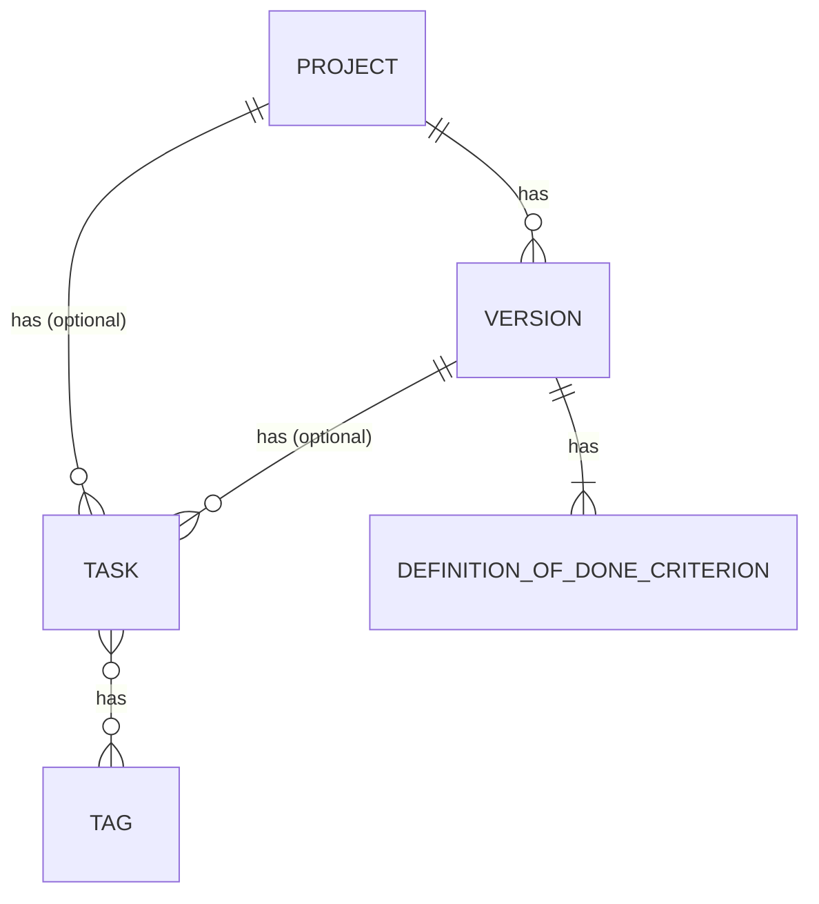
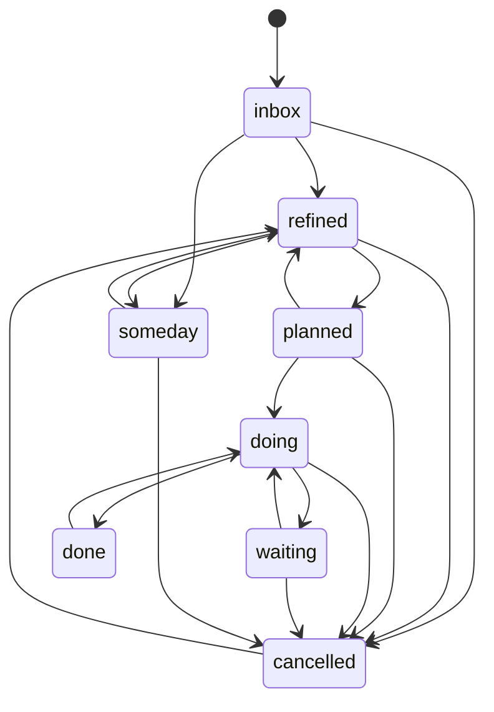
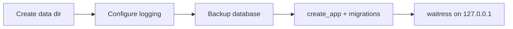

# Architecture overview

## Domain model

`Project → Version → Task`, one-to-many at each level. `Task.project_id`
and `Task.version_id` are independently nullable — this is the mechanism
behind the GTD workflow, not an edge case:

- `project_id IS NULL` → raw capture, not yet attached to a project
- `version_id IS NULL` → not yet planned (needs refining)
- both set → planned into a milestone

`Task` and `Version` also carry a short unique immutable `ref` (`t-4k2`,
`v-9xa`), generated by `services/refs.py`; projects are addressed by `key`
(see [0006](adr/0006-cli-shares-the-database.md)).

`Tag` is a free-form label, many-to-many with `Task` via a plain
association table. The `Event` table (append-only mutation log) isn't
shown here: it has no foreign keys by design, referencing any entity by
`entity_type` + `entity_id` so a log entry survives deletion — see
[0002](adr/0002-append-only-event-log.md).

## Definition of Done

Each version carries an ordered checklist of criteria
(`DefinitionOfDoneCriterion`: `description`, `position`, `done`, default
`False`). It is live: `services/versions.py` exposes `add_criterion`,
`update_criterion`, `delete_criterion` and `set_criterion_done`, allowed
while the version is `planned` or `in_progress`; on a released version they
raise `ConflictError`. Rules:

- An empty description raises `ValidationError`.
- The last criterion can't be deleted (`ValidationError`): the DoD stays
  mandatory.
- `versions.release` raises `ValidationError` while any criterion is
  unchecked.
- Each mutation logs a `dod_*` event on the version, visible in its
  changelog (see [0002](adr/0002-append-only-event-log.md)).

The web UI, the CLI and the MCP server all expose these operations
([0010](adr/0010-dod-editing-in-cli-and-mcp.md)).

`VersionProgress` (`services/views.py`) carries `dod_done` / `dod_total`
next to the task counts; the dashboard and version page render a DoD bar
beside the task bar. The version page also shows a task progress bar under
its "Tasks" heading ("done/total done" + `<progress>`), computed in the
template from the page's `tasks` list (state `DONE` over all tasks except
`CANCELLED`). The dashboard's version progress excludes cancelled tasks from
its total too.

## Task lifecycle

`waiting` requires a non-empty `blocked_reason`. `cancelled` is a terminal
state for abandoned work, distinct from `done`. Transition rules are
enforced in the services layer, implemented in `services/tasks.py` — see
[0001](adr/0001-services-ignore-http.md).

`tasks.change_state(session, task_id, target, reason="")` is a single entry
point over the working-state transitions: target `doing` dispatches to
`start` (from planned), `unblock` (from waiting) or `reopen` (from done);
`waiting` to `block` (needs `reason`); `done` to `complete`. Any other
target/state pair raises `InvalidTransitionError`; `NotFoundError` and
`ValidationError` come from the underlying transition. It also raises
`ValidationError` when the task's version is already released. Target
`cancelled` dispatches to `cancel`.

- `tasks.cancel(session, task_id)`: any open task (inbox, refined, planned,
  doing, waiting, someday) becomes `cancelled`. Sets `closed_at`, clears
  `blocked_reason`, and **keeps `version_id`** so the version's history still
  shows the task. Logs `cancelled` `{from, to}`. Raises
  `InvalidTransitionError` from `done` / `cancelled`, and `ValidationError`
  when the task's version is released.
- `tasks.restore(session, task_id)`: `cancelled` becomes `refined`, clearing
  `version_id` and `closed_at`. Logs `restored`. Raises
  `InvalidTransitionError` if not cancelled, `ValidationError` if its version
  is released.
- `tasks.move_to_version(session, task_id, version_id)`: moves a planned,
  doing or waiting task to another version of its project, keeping its
  state. Logs `moved` `{from, to, from_version_id, version_id}`. Raises
  `NotFoundError` (task or version), `InvalidTransitionError` (task not
  planned/doing/waiting) and `ValidationError` (current or target version
  released, target is the current version, target in another project).
- `versions.release` ignores cancelled tasks: a task is unfinished when it is
  neither `done` nor `cancelled`.
- Migration `3c1e5a7b9d20` rebuilds the `task_state` CHECK constraint to
  include `CANCELLED`. Its downgrade moves cancelled tasks back to `refined`
  with no version.

Within `services/`, mutations and cross-cutting reads are split into
separate modules: `services/tasks.py` (and `projects.py`, `versions.py`)
own single-entity commands, while `services/views.py` holds read-only,
page-shaped queries (`inbox`, `to_refine`, `search`, `dashboard`, `list_tasks`) that
don't belong to any one entity. Both stay framework-agnostic per ADR-0001.

Two further modules are read-only: `services/events.py` also holds the
event-log readers (`history`, `changelog`, see
[0002](adr/0002-append-only-event-log.md)), and `services/export.py`
provides `dump_json()`, a full database dump (projects, versions with their
definition of done, tasks with their tags, tags, events). Enums are exported
by name and dates in ISO 8601. The export is not re-importable (raw integer ids); bulk import is a
separate format, see `services/importer.py` below. `definition_of_done` is a
list of `{"description", "done"}` objects (it was a list of strings before
the live DoD; a breaking change for anything reading the export).

## Command line

`src/cli/` is a second adapter over `services/`, next to `web/`
([0006](adr/0006-cli-shares-the-database.md)): it shares the service's
SQLite database and calls the services directly, with no HTTP. Modules:
`main.py` (dispatch, exit codes), `views.py` (read commands, version actions), `add.py`, `import_cmd.py`,
`session.py`, `format.py`, `errors.py`, `commands.py` (registries). Usage:
[Command line](../functional/cli.md).

Three services exist for it: `services/refs.py` (ref generation and shape
check), `services/resolve.py` (project key / `t-` / `v-` reference to a row,
shared with the MCP server) and `services/importer.py` (bulk import, the MCP
entry point, [0007](adr/0007-importer-mcp-entry-point.md)). Events written by
the CLI carry actor `cli` (`events.ACTOR_CLI`). Every mutating service takes
an `actor` argument (default `web`, also `mcp`).

## MCP server

`src/mcp_server/` is a third adapter over `services/`
([0008](adr/0008-mcp-over-http-on-the-service.md)), serving AI assistants
through `POST /mcp` on the running service. Modules: `tools.py` (25 tools,
each a schema plus a handler calling services) and `serialize.py` (rows to
JSON, no integer ids), both transport-agnostic and Flask-free (enforced by
`tests/test_architecture.py`); `http.py` (the Flask blueprint: origin/host
guard, JSON-RPC dispatch, error shaping) is the only module that knows HTTP.
Tool calls run on the app's per-request session, roll back on refusal, and
log events with actor `mcp` (`events.ACTOR_MCP`). Usage:
[MCP server](../functional/mcp.md).

## Web pages

Besides the `/mcp` endpoint (see above), routes are unprefixed full-page adapters (package `web/pages/`, one `pages` blueprint defined in `_shared.py`; modules `projects`, `versions`, `tasks`, `inbox`):

- `/` is the dashboard: in-progress versions with done/total progress,
  `doing` and `waiting` tasks, inbox and refine counters
  (`views.dashboard()` returns a `DashboardView`).
- The task page shows its History; the version page shows its Changelog.
- The version page manages the DoD (checkbox, inline edit, delete, add form;
  read-only once released) through POST routes under
  `/projects/<key>/versions/<number>/dod` (add) and `/dod/<id>/toggle`,
  `/dod/<id>/edit`, `/dod/<id>/delete`. The version creation form takes one
  `dod` field per criterion (dynamic rows; newline-separated text is still
  accepted).
- The version page lists its planned tasks, each linked to
  `/tasks/<id>?next=<version page path>`. The version page builds `next` from
  the version's own URL (`url_for('pages.version_detail', ...)`), not
  `request.path`, because after a POST the request path is a POST-only URL.
  The task page (`_render_task`) passes `next` to `task.html` only if it is
  safe, and `task.html` appends it to every form action, so the task
  remembers its parent page. The helper `_local_path` (`web/pages/tasks.py`)
  returns the value only if it is a same-app relative path (starts with `/`,
  not `//`); `_safe_next` reuses it, so an unsafe value is neither linked nor
  carried in the forms. The back link goes to `next` ("← Back") when present,
  else to the task list ("← Tasks"). `_delete_task` redirects to `next` when
  `_safe_next` accepts it, otherwise to the default list (tasks list; inbox
  for an inbox delete).
- `POST /tasks/<id>/state` (`task_state`, `web/pages/tasks.py`) reads the
  form fields `state` (a `TaskState` name; unknown gives the error
  "unknown state.") and `reason`, calls `tasks.change_state`, and re-renders
  the task page with the error if any. The "State" select with a reason
  input is the shared partial `_task_state_form.html` (variables `task`,
  `state_action`), included by `task.html` and `version.html`. It offers only
  the valid next working states (planned: doing; doing: waiting, done;
  waiting: doing; done: doing), plus `CANCELLED` from planned, doing and
  waiting, alongside the per-state buttons on the task page, and is hidden
  for inbox, refined and someday tasks.
- `POST /tasks/<id>/cancel` (`task_cancel`) and `POST /tasks/<id>/restore`
  (`task_restore`, `web/pages/tasks.py`) call `tasks.cancel` / `tasks.restore`.
  `task.html` shows a "Cancel task" button (hidden for done and cancelled
  tasks) and, for cancelled tasks, a "Restore to refined" button.
- `POST /tasks/<id>/move` (`task_move`, `web/pages/tasks.py`) reads the form
  field `version_id`, calls `tasks.move_to_version` and re-renders the task
  page with the error if any. `_render_task` passes `versions` (the task's
  project versions) to `task.html`, which shows a "Move to version" select of
  the project's open versions other than the current one; hidden if there is
  none, or for tasks not planned/doing/waiting.
- `POST /projects/<key>/versions/<number>/task/<task_id>/state`
  (`version_task_state`, `web/pages/versions.py`) is the same change from the
  version page: each task row includes the partial, only while the version
  isn't released. It reads `state` and `reason`, returns 404 for an unknown
  project, version or task, or a task of another version, and re-renders the
  version page with the error on an unknown state or a service refusal.
- While the version isn't released, the version page also shows a "Candidate
  tasks" section, separate from its task list: the project's refined,
  unplanned tasks (`views.to_refine(session, project_key=..., limit=PAGE_LIMIT)`,
  passed as `candidates` by `_render_version`), each with a "+" button.
- `POST /projects/<key>/versions/<number>/task/<task_id>/plan`
  (`version_task_plan`, `web/pages/versions.py`) calls `tasks.plan` and
  re-renders the version page. It returns 404 for an unknown project,
  version or task, and shows the error on `InvalidTransitionError` /
  `ValidationError` (task not refined, released version, other project).
- `GET /export.json` downloads the export as an attachment.
- The nav bar links Dashboard, Projects, Tasks, Inbox, Refine, Search and
  Export.

## Runtime modules

Top-level modules under `src/` that run the app as a service (see
[0005](adr/0005-operational-layout.md)):

- `config.py`: `Config` (data dir, database URL, log file, backup dir and
  retention, `HOST` fixed to `127.0.0.1` per
  [0004](adr/0004-localhost-only.md), `PORT`).
- `main.py`: production entry point, `python -m src.main`.
- `backup.py`: online SQLite backup with pruning.
- `logging_config.py`: rotating file plus stderr handlers on the root logger.

List pages (`/search`, `/refine`, `/tasks`) show at most 100 rows.

### Startup sequence

The backup precedes migrations so a failed upgrade can be rolled back from
a snapshot. A failed backup is logged and startup continues.

## Decisions

See [Decisions](adr/0001-services-ignore-http.md) for the full ADR journal.
